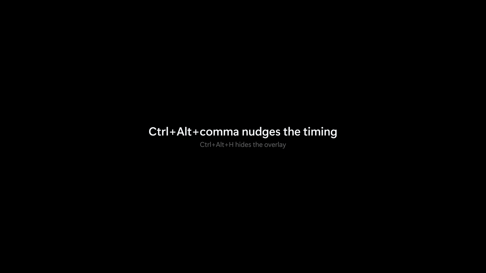
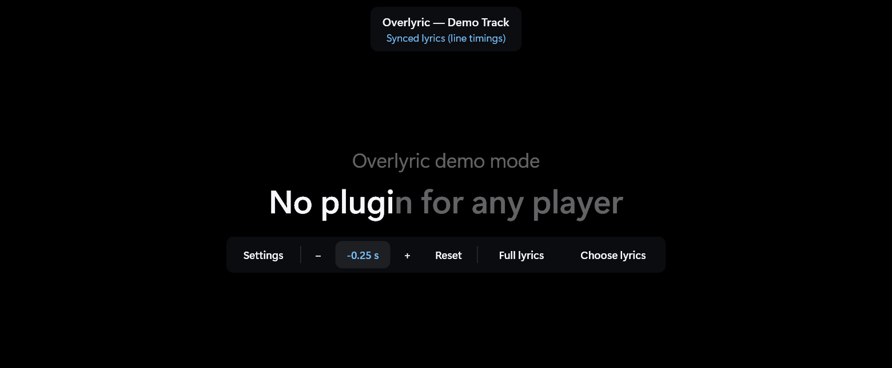

  

<h1 align="center">Overlyric</h1>

<strong>Lyrics for whatever is playing, over whatever you are doing.</strong>

Overlyric is a small Windows app that puts the words of the song you are listening to on top of
everything else — your games, your browser, your work. It reads what is playing from Windows itself, so
there is nothing to install in your player and nothing to switch on before the first song.

  

## Install

> [!NOTE]
> **Windows 10 (1809 or later) or Windows 11, 64-bit.**

Download **`Overlyric-0.4.0-x64-setup.exe`** from the [latest release][release] and run it.

- It installs for your account only — no administrator prompt, no background service.
- It starts in the notification area. There is no main window: play something and the lyrics appear.
- Uninstalling keeps your settings, cached lyrics and saved lyric files in `%LOCALAPPDATA%\Overlyric`,
  so reinstalling picks up where you left off.

Curious before playing anything? `Overlyric.exe --demo` drives the overlay from a canned song.

## What it does

- **Works with the players you already use.** TIDAL, Spotify, browsers, VLC, foobar2000, MusicBee, the
  built-in Media Player — anything that shows up in the Windows media controls is followed. Nothing to
  enable per player.
- **Usually finds the right lyrics first time.** Songs are matched by length rather than by the first
  search result, "- Remastered" and similar suffixes are ignored, and if a search comes up short it asks
  again with the album name.
- **Keeps time even when the player does not.** Some players report the playback position only now and
  then, or leave it frozen. Overlyric notices and keeps its own clock, so starting a song halfway still
  lands on the right line.
- **A correction that sticks.** Shift the lyrics a quarter second and the fix is remembered for that
  song — and, separately, for the headphones or speakers you were using.
- **Your own words when the database is wrong or empty.** Import a `.lrc` or `.txt` file, preview it
  against the song, and it is used instead of the internet. Translations work too: drop a
  `.trans.lrc` beside it.
- **Fix a line, not the file.** The lyric sheet is an editor: stamp timings as the song plays, nudge a
  line, undo, save, export. The public lyrics record is never modified.
- **Looks the way you want.** One line, one line plus the next, or several; karaoke sweep; a stage mode
  for parties and streams; an OLED preset that fights burn-in.
- **Gets out of the way.** It is click-through, it follows the cursor or a screen you pick, it hides
  itself for chosen apps such as calls and screen shares, and it can hide while your microphone is in
  use.
- **Says what went wrong.** If music is playing but nothing publishes, or a player reports no position,
  the tray icon says so instead of leaving you with an empty overlay. A diagnostics page answers "why is
  it showing this?" and copies itself as JSON for a bug report.

## Screenshots

*The karaoke sweep, captured live from `--demo`. The black is the capture background, not a theme — the
overlay itself is transparent.*

| | |
| --- | --- |
|  |  |
| **Full lyric sheet** — every line and timestamp, with the current line highlighted. | **Stage mode** — an opaque, full-monitor display for parties and streams. |
|  |  |
| **Settings** — four pages, one window. | **Controls** — unlock the overlay and move the mouse over it. |

## Keyboard shortcuts

| Shortcut | Action |
| --- | --- |
| `Ctrl+Alt+H` | Show or hide the overlay |
| `Ctrl+Alt+M` | Cycle one line → one line plus the next → several lines |
| `Ctrl+Alt+L` | Lock or unlock. Unlocked, the overlay can be dragged and takes the mouse wheel |
| `Ctrl+Alt+,` / `Ctrl+Alt+.` | Shift the lyrics a quarter second earlier or later |
| `Ctrl+Alt+0` | Reset the timing offset |

Every shortcut can be rebound in **Settings → Shortcuts** by clicking it and pressing the new
combination. Holding **Shift** while nudging changes the timing for this session only.

## Good to know

> [!IMPORTANT]
> The player has to publish a playback **position**, not just a title. Players that report metadata but
> keep the position at zero cannot be synced — Overlyric says so rather than parking on the first line.
> AIMP is the usual example; the fix is a plug-in that publishes properly.

> [!WARNING]
> **Not above exclusive fullscreen.** Windows bypasses the desktop compositor there, so the lyrics stop
> at the desktop. Borderless-windowed games and normal windows work. Overlyric deliberately does no
> injection and no hooking — that is what keeps it safe to run alongside games and anti-cheat.

## Learn more

| Page | What is in it |
| --- | --- |
| [Using Overlyric](docs/usage.md) | Hotkeys, control bar, tray, settings, moving and locking |
| [Lyrics](docs/lyrics.md) | How a version is chosen, the selector, imports and publishing |
| [OLED and burn-in](docs/oled.md) | The burn-in levers and the preset |
| [Configuration](docs/configuration.md) | Every `config.json` key and what it changes |
| [How it works](docs/architecture.md) | The technical story: sessions, the clock, rendering |
| [Development](docs/development.md) | Building it, probes, the installer, project layout |

It is one self-contained executable (about 11 MB) with no .NET runtime to install, and it sits at
around 65 MB of memory while playing. Everything else technical — measurements, the reasoning behind
the clock, why exclusive fullscreen cannot work — is in [the documentation](docs/README.md).

Lyrics come from [LRCLIB](https://lrclib.net/). Overlyric is not affiliated with any player or with
LRCLIB.

[release]: https://github.com/BarbarianTarkus/Overlyric/releases/latest
