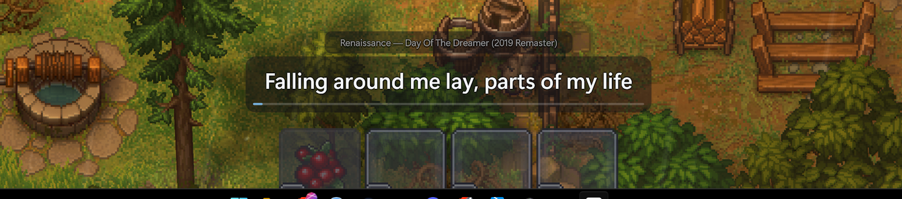
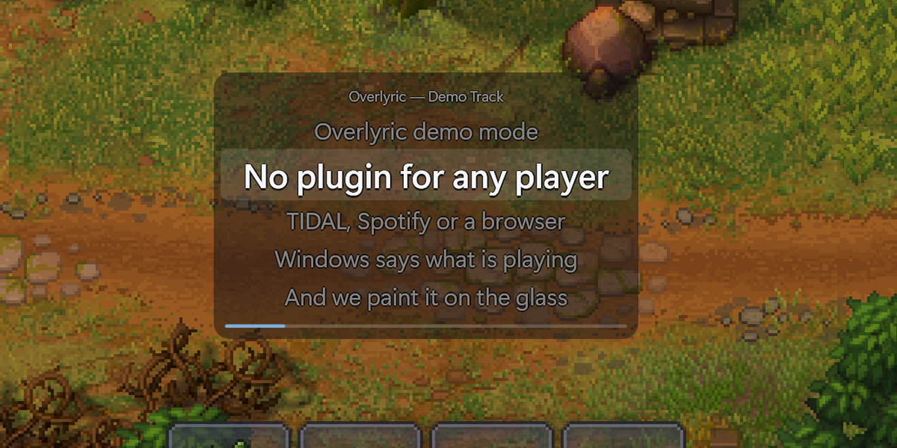
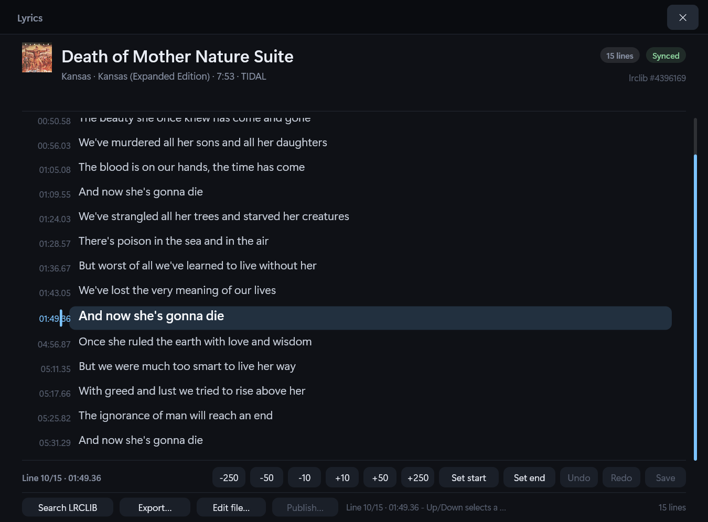
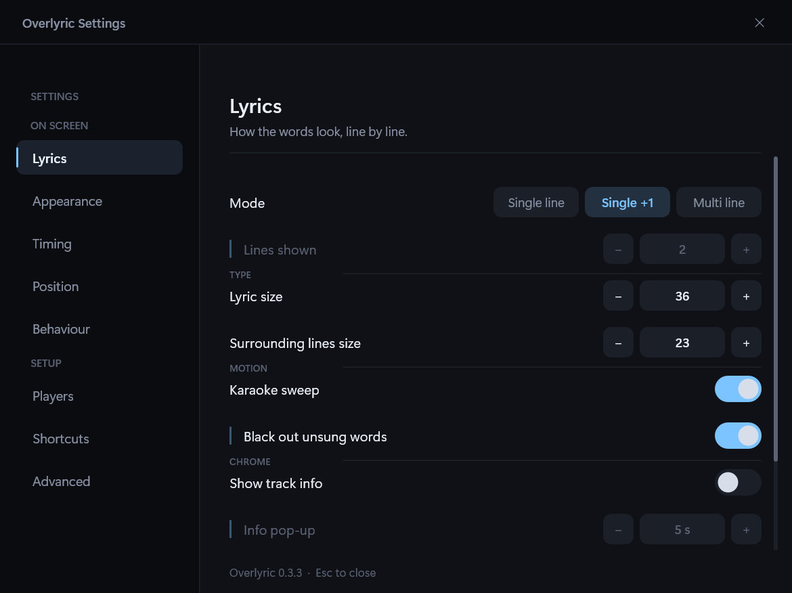
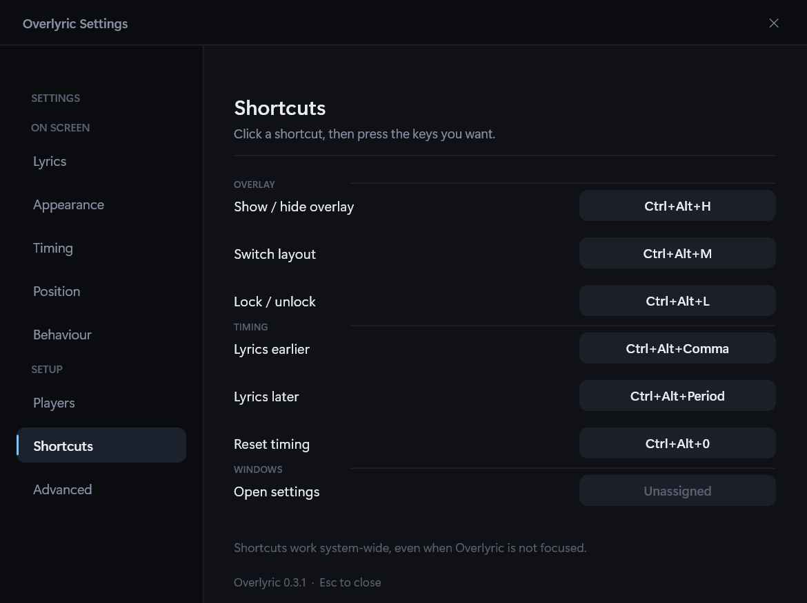
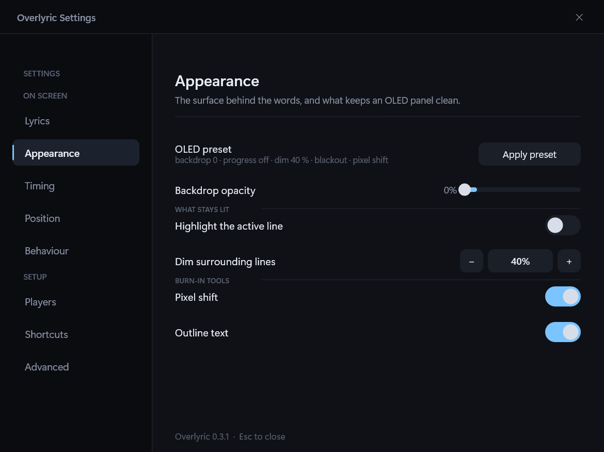
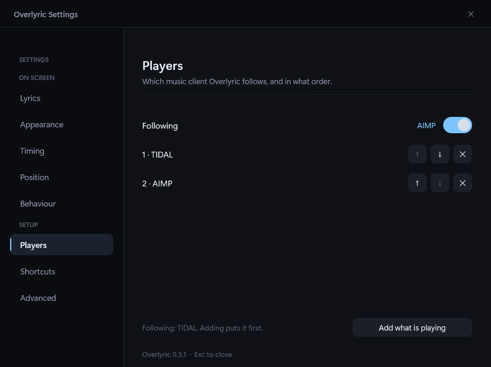

# Overlyric

**Lyrics for whatever is playing, over whatever you are doing.**

Overlyric is a Windows 10/11 lyric overlay. It reads the now-playing track from Windows' own media
controls, fetches synced lyrics from [LRCLIB](https://lrclib.net/), and paints them into a
GPU-composited, click-through window that stays above ordinary windows and borderless-windowed games.
There is no per-player integration to install. Deep dives live in [`docs/`](docs/README.md).



## What it does

- **Works with any player that publishes to Windows.** TIDAL, Spotify, browsers, VLC, foobar2000,
  MusicBee, the built-in Media Player — anything that registers with the system media controls
  (SMTC/GSMTC). Nothing to install or enable inside Overlyric.
- **Finds the performance you are actually hearing.** Release suffixes are stripped before querying,
  candidates are ranked by duration first, and an untimed pick is upgraded to the first record with
  timings that runs for the same length. If the first search misses, it asks again with the album.
- **Adapts to players that lie about the timeline.** Live timelines are followed; frozen ones (TIDAL)
  are self-clocked from a stopwatch, so starting mid-song still lands on the right line.
- **Fixes the timing once.** A nudge is saved for the track and comes back on replay; a correction
  saved for the current output device (headphones, speakers, Bluetooth) is used when the track has
  none, and the global offset is the fallback. The bar and the toast name the layer in force.
- **Fixes the words too.** When LRCLIB has the wrong version or nothing at all, import a local
  `.lrc`/`.txt` (UTF-8, UTF-16 or ANSI), preview it against the track, and it is used instead of the
  network and marked **Local**; any timed sheet exports back to LRC. A deleted local file falls back
  with a sentence, not silence.
- **Fixes timing line by line.** The lyric sheet is an editor: stamp a line's start or end from the
  playing position, nudge by 10-250 ms (or hold Shift to shift the whole sheet), undo/redo, save it
  as the track's local sheet, export LRC, or hand the `.lrc` to Notepad and let it reload on save.
  The LRCLIB record itself is never modified.
- **Single line, single line plus the next, or multi line**, with word- or line-timed karaoke sweep, a
  manual version selector, and a full lyric sheet with timestamps.
- **Built for an OLED desktop**, with a one-click burn-in preset: no backdrop, pixel shift, outline
  text, and the unsung half of the current line left unlit.
- **Says when something is wrong.** If audio is playing but no player publishes, or a player publishes
  no position, the tray says so instead of leaving you with a silent overlay.
- **Refreshes or previews on demand.** A wrong or missing record can be asked for again from the tray,
  and the demo track can be shown for fifteen seconds without a player.

## Screenshots


The karaoke sweep, captured live from `--demo`. The overlay has a transparent backdrop, so the black
is the capture background, not a theme. Run `Overlyric.exe --demo` to try it with nothing playing.

| Multi line | Full lyric sheet |
| --- | --- |
|  |  |
| The same game, `--demo` driving a canned track. | Every line and timestamp, with the line being sung highlighted. |

| Lyrics | Shortcuts |
| --- | --- |
|  |  |
| Mode, lines shown, text sizes, the karaoke sweep, and the track info and info pop-up it owns. | Every global hotkey, rebound by pressing the new combination. |

| Appearance | Players |
| --- | --- |
|  |  |
| Backdrop, what stays lit, and the burn-in preset and tools. | Who is followed, and the order the rest are tried in. |

Settings captures show one machine's configuration, not the defaults. The
[screenshot gallery](docs/README.md#screenshots) has the lyric selector and the rest of the settings
window.

## Quick start

Overlyric is a single self-contained executable; there is no .NET runtime to install. Build it with
the command under [How it's built](#how-its-built), or install the MSI produced by
`installer\build-installer.ps1`, then start `Overlyric.exe`. It lives in the notification area —
there is no main window. Play something and the overlay appears.

| Shortcut | Action |
| --- | --- |
| `Ctrl+Alt+H` | Show / hide the overlay |
| `Ctrl+Alt+M` | Cycle single line → single + next → multi line |
| `Ctrl+Alt+L` | Lock / unlock. Unlocked, the overlay can be dragged and takes the mouse wheel |
| `Ctrl+Alt+,` / `Ctrl+Alt+.` | Shift the lyrics 0.25 s earlier / later |
| `Ctrl+Alt+0` | Reset the timing offset |

Every shortcut can be rebound in **Settings → Shortcuts**. `Overlyric.exe --settings` opens the same
window directly. The [usage guide](docs/usage.md) covers the control bar, the tray menu, the lyric
selector and the viewer.

## How it works

```
 any player
    │  Windows media controls (SMTC)
    ▼
 MediaSessionWatcher ──▶ LyricsService ──▶ LRCLIB / cache
    │                        │
    ▼                        │
 PlaybackClock ──────────────┴──▶ OverlayWindow
                                  DirectComposition + Direct2D
```

Four decisions do most of the work:

- **Read Windows, not the player.** Windows exposes every registered media session through one API,
  the same source that drives the media keys and the volume flyout. Overlyric polls it, so a new player
  works the day it registers. A player that never registers cannot be supported — AIMP is the usual
  example, and the fix is a plug-in that publishes properly, not a setting in Overlyric.
- **Choose the record, not the first hit.** LRCLIB holds many records per song. Duration dominates the
  ranking, release suffixes are stripped so the right family is queried at all, and when the ranked pick
  has no timings the app looks for the first synced record of the same length. A second, album-scoped
  search covers the case where LRCLIB's twenty-result cap hides it.
- **Do not trust the reported position.** TIDAL reports metadata but freezes the timeline, so the clock
  uses a monotonic stopwatch and ages the reported position by the wall clock since it was stamped.
  Players with a live timeline re-anchor it, but only when drift exceeds 400 ms.
- **Draw without a UI framework.** A `WS_EX_NOREDIRECTIONBITMAP` window composited by DirectComposition
  means the GPU blends the lyrics: no per-frame CPU pixel copy, no focus stealing, and a redraw only
  when the visible content changes.

The long version, including the measurements behind each claim, is in
[How it works](docs/architecture.md) and [Lyrics](docs/lyrics.md).

## How it's built

- **NativeAOT on .NET 10** — one self-contained executable, no runtime install, no JIT warm-up.
- **Win32 + Direct2D/DirectWrite + DirectComposition**, through Vortice. No WPF, WinUI or WinForms;
  those would cost more memory before the first lyric is drawn than the whole process does.
- **Cached text layouts and zero per-frame allocations.** The progress bar does not allocate to move.
- Every platform assumption was measured first with a throwaway probe; the probes are still in
  [`probe/`](probe/) and documented in [Development](docs/development.md#probes).

Measured on Windows 11, 3840×2160 at 150 % with TIDAL playing over a running game:

| Metric | Value |
| --- | --- |
| Working set | ~65 MB, flat over 3+ minutes |
| CPU | ~0.2 s per 150 s of playback (≈0.15 % of one core) |
| Executable | 9.9 MB, single file, no .NET runtime installed |
| Handles / threads | ~1280 / ~25 |

```powershell
dotnet publish src\Overlyric\Overlyric.csproj -c Release
```

That produces `src\Overlyric\bin\Release\net10.0-windows10.0.26100.0\win-x64\publish\Overlyric.exe`.
Building needs the .NET SDK 10 and the MSVC toolchain for the NativeAOT link;
[Development](docs/development.md) has the rest, including the installer.

## Honest limits

- **Not above exclusive fullscreen.** Windows bypasses the desktop compositor there, so only code
  injected into the game (or a display driver) can draw. Overlyric deliberately does no injection, no
  hooking and no DLL loading. Borderless-windowed games and normal windows work.
- **The player has to publish — a title alone is not enough.** A player that publishes no position
  cannot be synced; the overlay says so rather than parking on the first line. Some AIMP plug-ins
  publish metadata but leave the timeline at zero, which is equally unusable; `aimp-smtc-sync`
  publishes a real one.
- **Windows 10 1809 or newer, x64.** Windows 11 recommended.

## Documentation

| Page | What is in it |
| --- | --- |
| [How it works](docs/architecture.md) | Sessions, source selection, the adaptive clock, failure diagnosis, rendering |
| [Lyrics](docs/lyrics.md) | Record matching, the version selector, the full sheet, LRCLIB, instrumentals |
| [Using Overlyric](docs/usage.md) | Hotkeys, control bar, tray, settings, karaoke, moving and locking |
| [OLED and burn-in](docs/oled.md) | The burn-in levers and the preset |
| [Configuration](docs/configuration.md) | Every `config.json` key, the cache, pinned versions |
| [Development](docs/development.md) | Build, icon, resource budget, probes, project layout |
| [Fullscreen feasibility](docs/fullscreen-overlay-feasibility.md) | Why true exclusive fullscreen cannot work |
| [Documentation index](docs/README.md) | All of the above, with the screenshot gallery |

Lyrics are fetched from [LRCLIB](https://lrclib.net/). Overlyric is not affiliated with any player or
with LRCLIB.