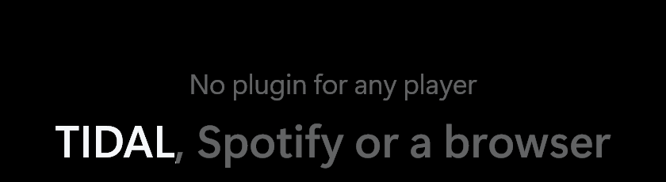
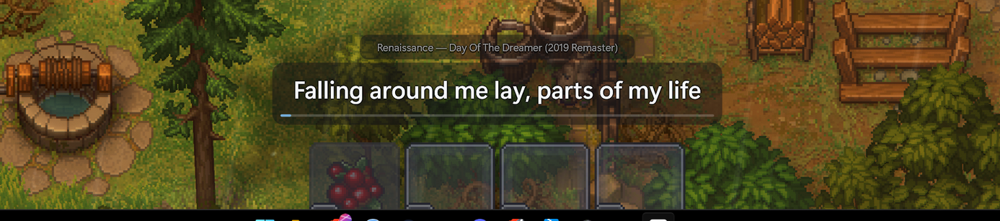
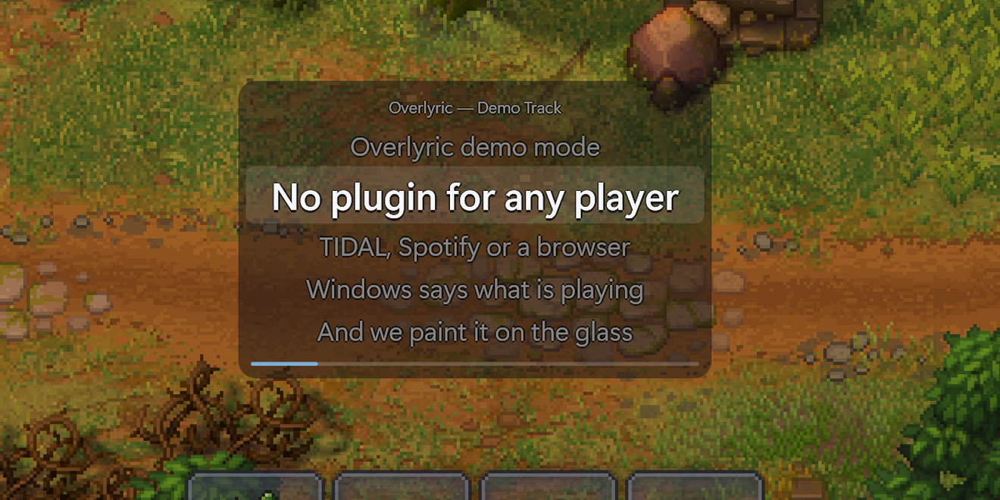
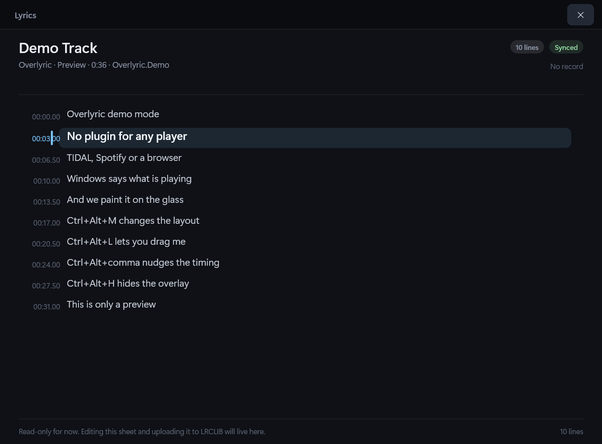
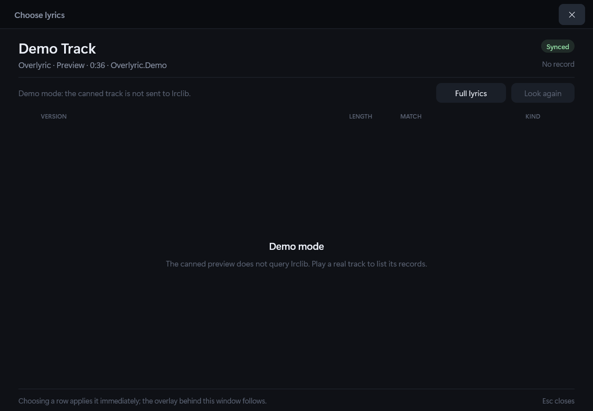
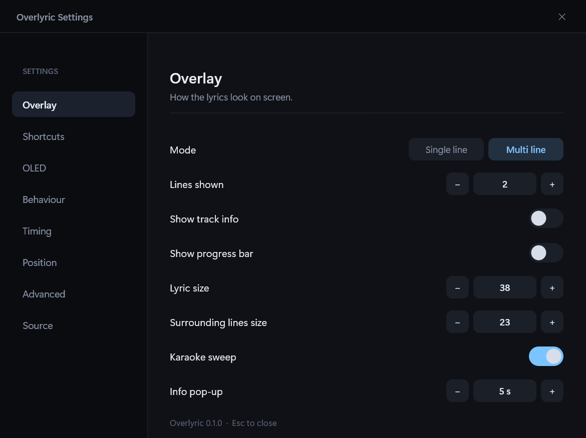
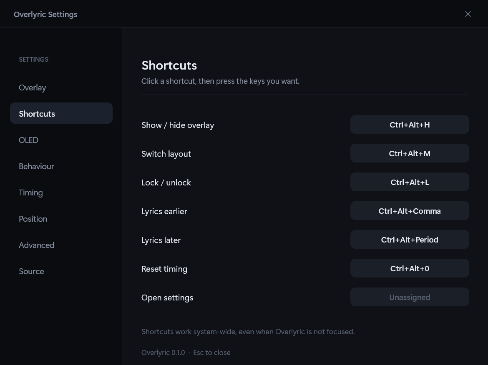
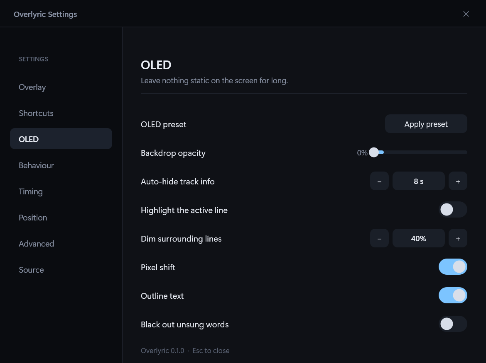
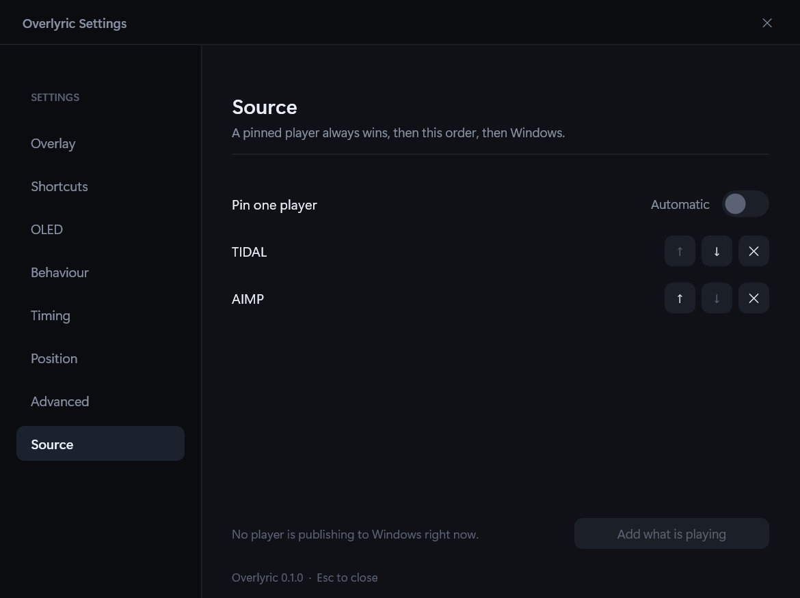

# Overlyric documentation

The [README](../README.md) is the short version. These pages are the reference: the reasoning behind
the design, the exact behaviour of each feature, and the measurements the claims rest on.

## Start here

| Page | What it covers |
| --- | --- |
| [How it works](architecture.md) | The media-session pipeline, choosing a player, the adaptive clock, the failure diagnosis, and why the overlay is built on DirectComposition |
| [Lyrics](lyrics.md) | Matching the right LRCLIB record, the manual version selector, the full sheet, and instrumental detection |
| [Using Overlyric](usage.md) | Global hotkeys, the overlay control bar, the tray menu, the settings window, karaoke, moving and locking the overlay |
| [OLED and burn-in](oled.md) | The burn-in controls and the one-click OLED preset |
| [Configuration](configuration.md) | Every key in `config.json`, the lyric cache and pinned versions |
| [Development](development.md) | Requirements, build, resource budget, the probes, and the project layout |
| [Fullscreen feasibility](fullscreen-overlay-feasibility.md) | Why borderless works, why true exclusive fullscreen cannot, and what the alternatives would cost |

The supporting research for the fullscreen question lives in [`feasibility/`](feasibility/).

## Screenshots

Every screenshot is of the running application. The game in the overlay captures is *Core Keeper*.
Settings and demo captures show one user's configuration, not the defaults.

**The karaoke sweep**, captured from the overlay window in `--demo`. The overlay has a transparent
backdrop, so the black is the capture background rather than a theme.

### Overlay

| Single line | Multi line |
| --- | --- |
|  |  |
| Following live TIDAL. The sweep has lit the first half of the line. | `--demo` driving a canned, synced track over the same game. |

### Lyrics windows

| Full lyrics | Choose lyrics |
| --- | --- |
|  |  |
| The sheet in demo mode. A real track carries its LRCLIB record id; demo tracks do not. | Demo tracks are deliberately not sent to LRCLIB, so the list is empty here. A real track lists its records. |

### Settings

| Overlay | Shortcuts |
| --- | --- |
|  |  |
| Mode, lines, track info, progress bar, text sizes, karaoke and the info pop-up. | Click a chord, press the new combination, and it registers immediately. |

| OLED | Source |
| --- | --- |
|  |  |
| After **Apply preset**: no backdrop, no highlight bar, dimmed surrounding lines. | Pin one player, or order the ones to prefer; the list is tried before Windows' own choice. |

The [README](../README.md) uses a shorter selection.