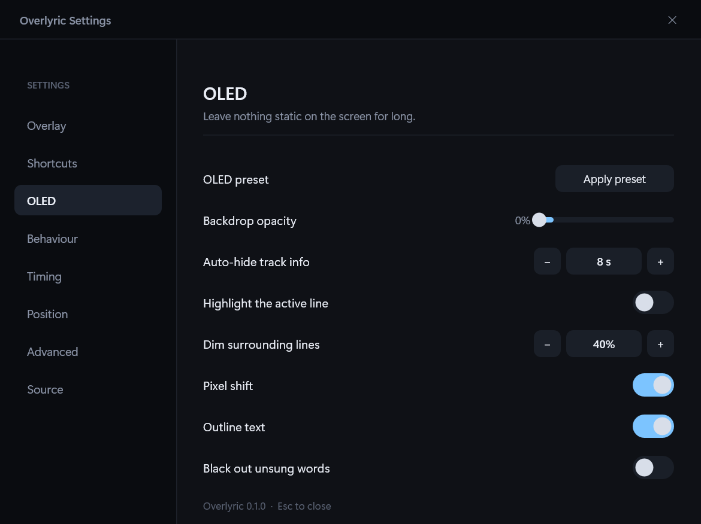

# OLED and burn-in

An OLED panel wears where the same pixels stay lit for hours, and a lyric overlay is exactly that: the
backdrop is a large static rectangle, the progress bar never moves except at one edge, the track info
is identical for the whole song, and the surrounding lines sit in the same place for minutes. The
**OLED** section exists to take all of that away.

**Apply preset** sets the whole bundle in one click: backdrop to zero, progress bar off, track info
gone after eight seconds, no highlight bar, surrounding lines dimmed to 40 %, the unsung half of the
current line blacked out, pixel shift on, outline text on, and hide when paused. It also turns the
karaoke sweep on, because the blackout has nothing to draw without it. Every one of those is also a
separate control, so the preset is a starting point rather than a mode.

| Lever | What it does |
| --- | --- |
| **Backdrop opacity** | Goes all the way to 0. At 0 the backdrop is not drawn at all — the window is pure text |
| **Auto-hide track info** | Seconds before `Artist — Title` fades out; `Never` keeps it |
| **Highlight the active line** | The translucent bar behind the line being sung |
| **Dim surrounding lines** | Opacity of the lines around the active one |
| **Pixel shift** | Nudges everything 3 px around a four-step cycle, one step per minute of playback |
| **Outline text** | A hard one-pixel outline instead of the soft shadow |
| **Black out unsung words** | The half of the active line the sweep has not reached is drawn in pure black, so only the sung part is lit |

Three of these interact, and are worth knowing about. A transparent backdrop is only legible over bright
video if the text has an edge, which is what **Outline text** is for — the soft shadow alone is not
enough once the backdrop is gone. And **Pixel shift** moves the *drawing*, not the window: placement,
dragging and hit testing are untouched, so nothing has to be re-measured and no position is written to
the config.

The third is **Black out unsung words**, which only shows while the karaoke sweep is running: it
blackens the part of the active line the sweep has not reached. On a transparent backdrop those
words are black shapes rather than lit ones, so over a dark scene they disappear entirely and the
line lights up as it is sung. That is deliberate: without the blackout those words are the one part
of a swept line that is both standing still and emitting light.

The preset leaves the info pop-up alone. It is up for a few seconds at a time, which is too little
for a stuck pixel, so suppressing it would cost an answer without buying anything.