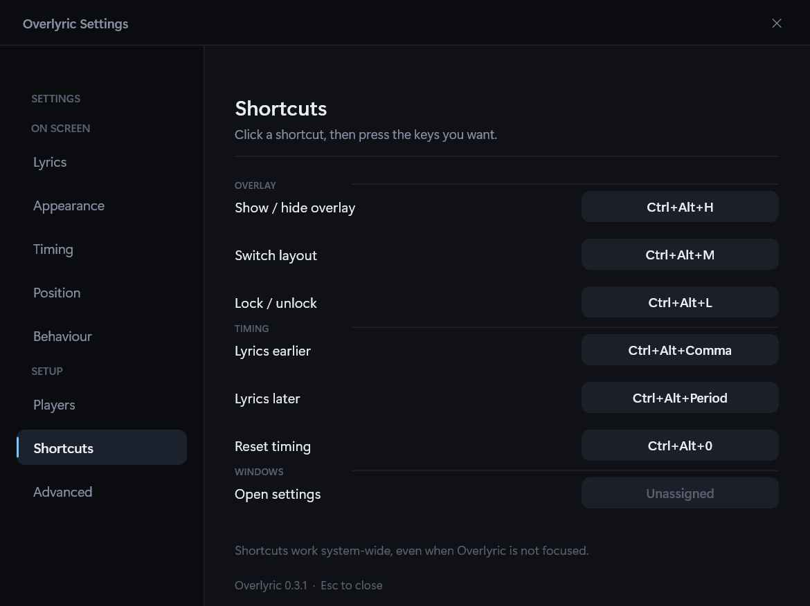
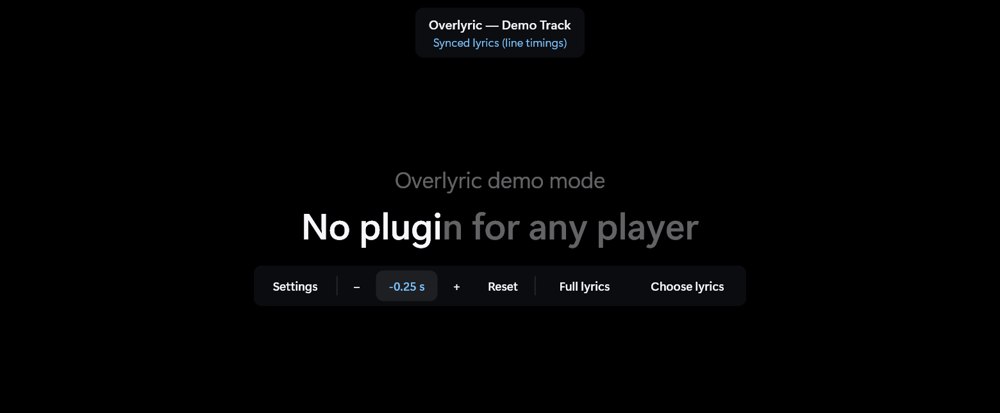
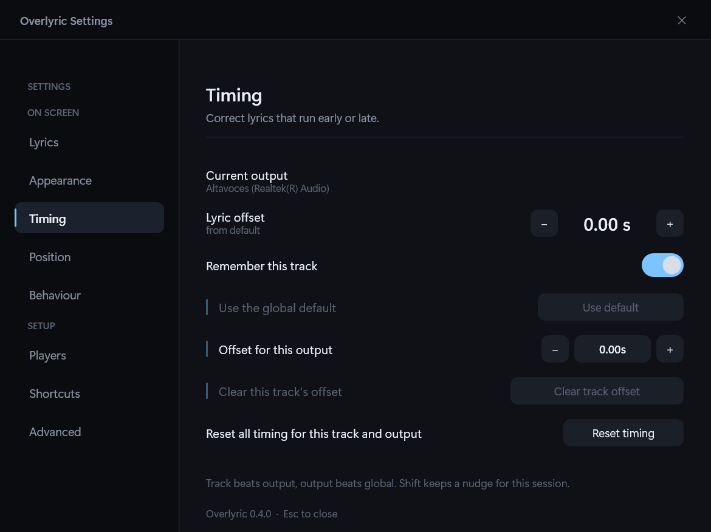
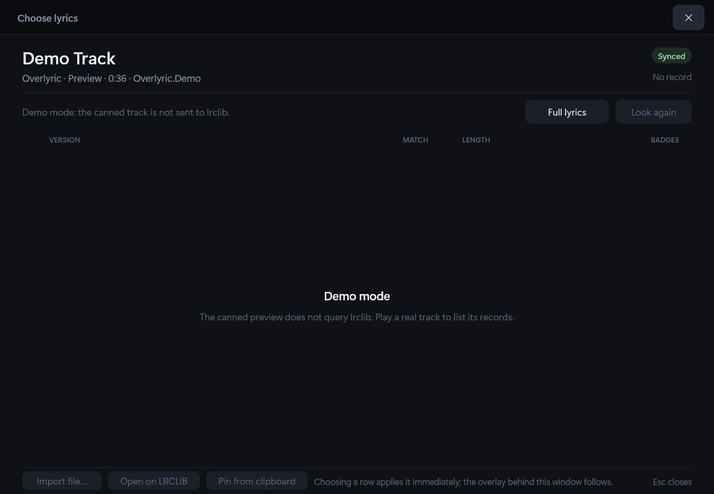
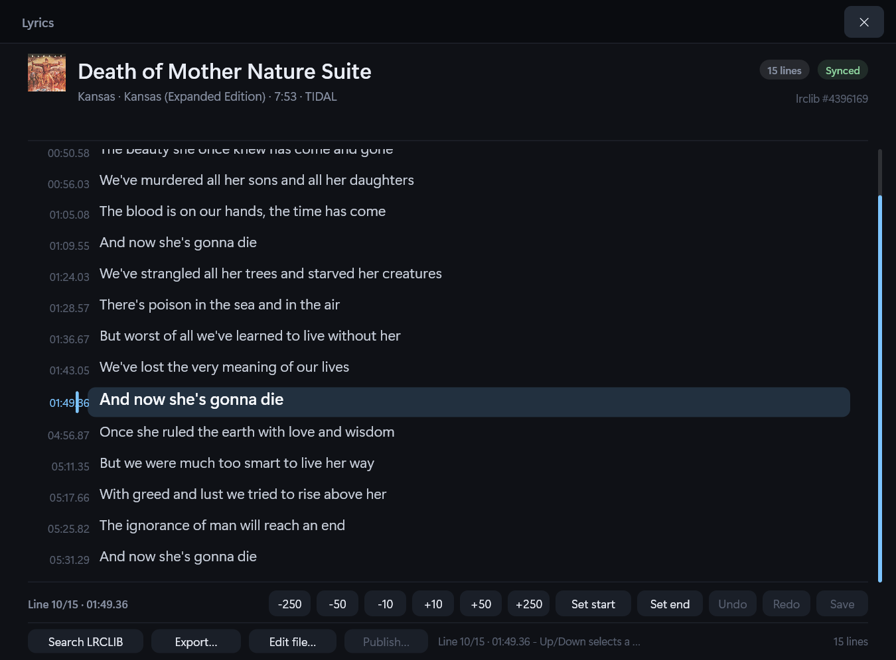
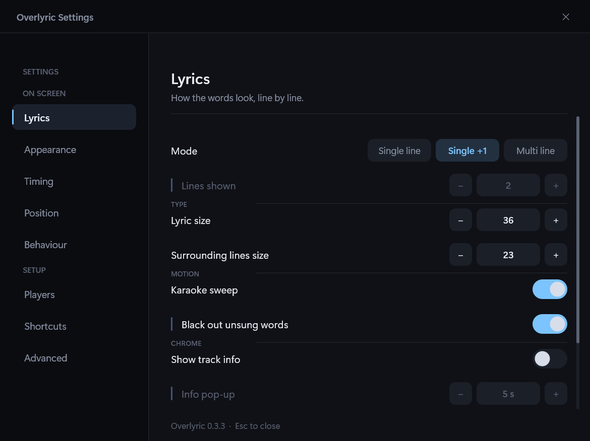
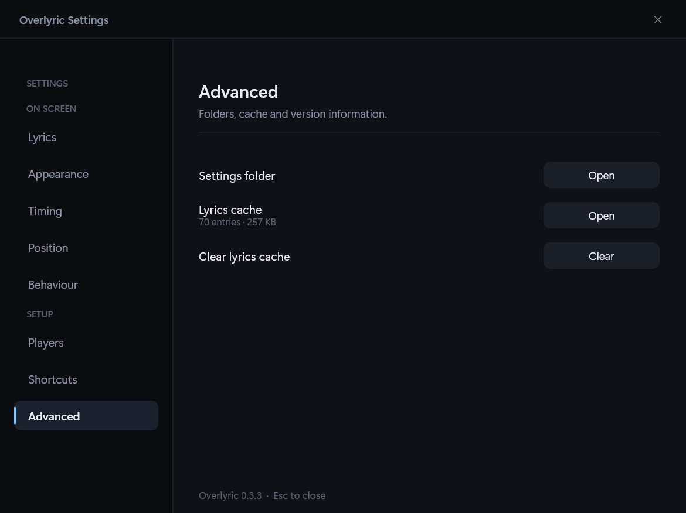

# Using Overlyric

Overlyric has no main window. This page is about steering it once it is running: the shortcuts, the
control bar, the tray, the settings window, and the lyric windows.

## Running Overlyric

Start `Overlyric.exe`. It lives in the notification area; start playing something in any player and
the overlay appears.

To preview the overlay without playing anything:

```powershell
Overlyric.exe --demo
```

Demo mode drives the overlay from a canned synced track, so you can judge the look, try all three
layouts and drag it around with nothing playing.

To show the same canned track for fifteen seconds without restarting, right-click the tray icon and
choose **Preview overlay**. `Overlyric.exe --preview` does the same for a script or a screenshot.

To open the configuration window without going through the tray:

```powershell
Overlyric.exe --settings
```

## Global hotkeys

| Shortcut | Action |
| --- | --- |
| `Ctrl+Alt+H` | Show / hide the overlay |
| `Ctrl+Alt+M` | Cycle single line → single + next → multi line |
| `Ctrl+Alt+L` | Lock / unlock. Unlocked, the overlay becomes draggable and accepts the mouse wheel |
| `Ctrl+Alt+,` | Shift lyrics earlier by 0.25 s |
| `Ctrl+Alt+.` | Shift lyrics later by 0.25 s |
| `Ctrl+Alt+0` | Reset the timing offset |

These are the defaults. Every one of them can be rebound in **Settings → Shortcuts**: click the
shortcut, press the combination you want, and it is registered immediately. A combination that is
already used by another action, or already taken by another application, is refused with the reason
shown instead of being silently swallowed; a shortcut with no Ctrl, Alt or Win is refused too.
`Open full lyrics` and `Choose lyrics` ship unbound too, so a Stream Deck or macro can open
either window without a tray trip, and `Open settings` completes the set.

A timing nudge is saved for the track you are hearing, so the correction is still there when the song
comes around again. Hold **Shift** while nudging — or turn off **Remember this track** in Timing — to
adjust only for the current session.

Every global hotkey confirms itself with a small toast. It names the state the shortcut just entered,
and a timing nudge names the resulting total offset **and the layer it came from** rather than
repeating the step: `Ctrl+Alt+,` reads `Offset -0.25s · this track`, and a second press reads
`Offset -0.50s · this track`. Without a saved track correction the same line ends in
`· this output` or `· default`. The toast is drawn in its own click-through window, opposite the
overlay's anchor — so "Overlay hidden" can still say so after `Ctrl+Alt+H` has made the lyric window
disappear — and it dismisses itself after 1.8 seconds.



## Overlay controls

**Unlock the overlay and move the mouse over the lyrics**: a control bar appears in the same window.
It disappears again about half a second after the pointer leaves, and it never appears at all while
the overlay is locked — locked is click-through, which means no surface to hover.

| Control | What it does |
| --- | --- |
| **Single / Single +1 / Multi 2** | The layout in force. Click it to cycle, exactly as `Ctrl+Alt+M` does — it is a readout before it is an action |
| **− / +** | Nudge the lyric timing by 0.25 s. The value shows the resulting total and its source, e.g. `+0.25 s · this track`; the nudge is saved for the track unless Shift is held |
| **↺** | Reset the timing for the track and output on screen: clears the track override, this output's profile and the global default. Dimmed when they are all already zero |
| **Lyrics** | Open the complete lyric sheet |
| **Versions** | Open the lyric selector |
| **Settings** | Opens the settings window |
| **Lock** | Lock the overlay. The bar only exists unlocked, so this is the end-of-session gesture, and it needs no remembered chord |

The bar reads left to right as status, correction, windows, finish: what you are looking at, the timing
you are fixing, the two windows that show the words, then the two things that end the session.



*Captured from the overlay window itself; the background is black because the window has a transparent
backdrop.*

The bar is drawn above the lyrics when there is room and below them when there is not, and it brings
its own backdrop, so it stays readable with the OLED preset's fully transparent backdrop. It is
deliberately outside the burn-in pixel shift: a button that moves under the pointer is a button that
is hard to hit. The settings window is topmost like the overlay, and the overlay stops re-asserting
its own z-order while one of Overlyric's windows is open — otherwise the lyrics would climb back over
the window you are reading every few ticks.

The **Single +1** layout — Settings → Lyrics, or `Ctrl+Alt+M` — keeps the active line at full size
and shows the next line dimmed underneath. During a wait longer than three seconds, such as an intro
or an instrumental break, a thin line under the lyrics fills with the wait. It is a sign that the
player is still moving, not a second track progress bar.

## Timing: once per track, once per output

Timing error comes from three places with different scopes, so the correction is stored at the
narrowest one that explains it. The layers are **overrides, not additions**:

1. **This track** — where a nudge is saved by default, and restored the next time the track plays.
2. **This output** — used when the track has no saved correction. **Settings → Timing → Offset for
   this output** sets it for the device Windows currently calls the default.
3. **The global default** (`LyricsOffsetMs`) — the fallback when neither exists.

A track is identified by a normalised artist and title, so a different album tag or capitalisation
still finds the correction. The control bar, the toast and the Timing section all name the layer in
force: `+0.25 s · this track`, `+0.15 s · Bluetooth headphones`, `+0.25 s · default`. Switching
output applies that device's profile within five seconds, and immediately on a track change.

Three gestures keep a one-off adjustment from becoming permanent: hold **Shift** while nudging, turn
**Remember this track** off, or nudge from a context with no usable track metadata. Those corrections
read `· this session`, last until the track or output changes, and are never written to
`config.json`. **Use default** drops a track override so the output or global value applies again;
**Clear track offset** stores an explicit zero for this track over its output profile; **Reset
timing** returns the current track and output to zero.

Windows reports engine latency, not Bluetooth codec latency, so Overlyric never guesses a Bluetooth
offset: the Timing section says the output is Bluetooth and leaves the number to the listener's ears.



*The current output, the correction in force and the layer it came from. The track and output
buttons are dimmed until there is a value to clear; the hint at the bottom spells out the precedence.*

## Tray icon

Left-click toggles the overlay. Right-click opens a deliberately short menu: the track line
(informational — greyed out and not selectable), **Full lyrics…** (the sheet), **Versions…** (the
selector), **Refresh lyrics**, **Preview overlay**, **Players** (automatic, whatever is publishing now,
and the priority order), then the three state switches worth reaching for mid-song — **Show overlay**,
**Layout** and **Locked** — and finally **Settings…** and **Exit**. **Layout** opens a submenu with the
three modes ticked, because a row that cycles them cannot show which one is in force. Everything else
moved into the settings window, because a menu that dismisses itself on every click is a poor place to
change anything.

**Refresh lyrics** throws away the cached answer for the current track and asks LRCLIB again. It is
the escape hatch for a record that is wrong, or for a lookup that failed while the network was down.
**Preview overlay** drives the demo track for fifteen seconds, which is the quickest way to check a
layout, a font size or the OLED preset without waiting for a song.

## The lyric selector and viewer

**Choose lyrics** — from the overlay controls or the tray — opens the selector described under
[Choosing a version by hand](lyrics.md#choosing-a-version-by-hand). It is a normal window, not a menu: it can
show song details, a badge per record, lengths and match deltas side by side, and it stays open while
the listener compares choices and hears each one on the overlay behind it. The list scrolls with the
wheel, the scrollbar and the keyboard; **Automatic (best match)** is the first row.

The selector also owns the local lyric library: **Import file…** previews a `.lrc` or `.txt` against
the track and, once accepted, that file is used instead of LRCLIB and badged **Local**;
**Open on LRCLIB** and **Pin from clipboard** are the escape hatches for a wrong query without a text
box. [Your own lyric file](lyrics.md#your-own-lyric-file) has the details.



*Demo tracks are deliberately not sent to LRCLIB, so the list is empty here; a real track lists its
records, best first.*

**Full lyrics** opens the complete sheet described under [The complete lyric sheet](lyrics.md#the-complete-lyric-sheet).
Its **Search LRCLIB** button (or `Ctrl+F`) opens a query field when the automatic lookup cannot find the
song, and a result picked there is pinned for the track and shown immediately; **Export…** writes the
timed sheet in force as an LRC file. The sheet is also a timing editor: Up/Down selects a line,
**Set start**/**Set end** stamp it with the current playback position, the nudge buttons move it by
10/50/250 ms (hold **Shift** to shift every line), and **Undo**/**Redo**/**Save** work as described
under [Editing the timing](lyrics.md#editing-the-timing). **Edit file…** opens the local `.lrc` in
Notepad and reloads the sheet when it is saved. Saving writes a local selection, so the edit survives
a replay without changing the LRCLIB record. Both windows are
dark, resize from any edge or corner, and close with **Esc**; they reuse the overlay's
DirectComposition stack and the settings window's palette, so they add no new UI framework. The
selector's title column takes the extra width, while its match, length and badge columns stay
anchored to the right; the sheet re-wraps its lines at the new width.



*The sheet in demo mode. A real track also carries the LRCLIB record it came from; demo tracks do not.*

## Command line and scripting

A second launch does not start a second overlay: it forwards its arguments to the instance that is
already running, over the local named pipe `Overlyric.Commands.v1`. That makes the app scriptable
from Stream Deck, AutoHotkey, a shortcut or a batch file:

```powershell
Overlyric.exe --toggle            # show/hide the overlay
Overlyric.exe --show              # or --hide for an explicit state
Overlyric.exe --layout=peek       # single, peek (single + next), multi, or next to cycle
Overlyric.exe --offset=-250       # nudge this track 0.25 s earlier (or +250, or reset)
Overlyric.exe --lock              # or --unlock
Overlyric.exe --preview           # show the canned demo track for fifteen seconds
Overlyric.exe --settings          # open the settings window
Overlyric.exe --diagnostics       # open the diagnostics window
Overlyric.exe --refresh           # ask LRCLIB again for the current track
Overlyric.exe --exit              # quit, tray and all
```

The forwarded command is executed on the running instance's UI thread, so it behaves exactly like
the menu item or hotkey it names. An unknown switch exits with code 2 and is recorded in the
diagnostics log rather than being accepted silently. `--demo`, `--settings` and `--preview` on the
first launch still mean what they did.

## Diagnostics

**Diagnostics…** in the tray opens a read-only window that answers "why is it showing this?": the
session and playback state, whether the clock is following a live timeline or self-clocking, where
the lyric sheet came from (local file, pinned record, automatic, cache), the line count and verdict,
the timing in force and which layer supplied it, the output device, the chosen display, the
foreground app and whether a hide rule matched, and whether the fullscreen notice is active. The
bottom shows the last events from a small rolling log.

**Copy as JSON** puts the whole snapshot on the clipboard for a bug report, and **Open log folder**
opens the folder that holds `diagnostics.log`. The log is bounded in memory (256 lines) and on disk
(256 KB, rotated in place), so it can be left running without growing without limit.

## Settings window

`Settings…` in the tray, or `Overlyric.exe --settings`, opens a resizable dark window with eight
sections down the left, in two groups. **ON SCREEN** holds **Lyrics** (mode, lines shown, text sizes,
the karaoke sweep, and the track info and info pop-up that belong together), **Appearance** (the
backdrop, what stays lit, and the burn-in preset and tools — see [OLED and burn-in](oled.md)),
**Timing** (the current output and the track/output/global corrections), **Position** (which
display, anchor, offsets, reset) and **Behaviour** (the hide rules, the per-app hide list, the
warnings, and start with Windows). **Appearance** also carries the **Palette** (Default, Warm, Cool
or Mono) and the **Active line weight** (Normal, Semibold or Bold); both move the text and accented
controls together, and the OLED preset is still a separate bundle of levers. **Show translation**
toggles the optional second-language sidecar under the active line. **SETUP** holds **Players** (which music client to follow, and the
order to prefer them in), **Shortcuts** (rebind the global hotkeys) and **Advanced** (the folders, the
cache and its size, clearing it, the local lyric folder, and the version).

The sections are ordered by the job rather than by the order the features shipped: what it looks like,
then the two corrections made most often, then when it gets out of the way, then the setup. Inside a
section, a row that only means something because of another row sits under it, indented, and stays
dead until that row is on — turn **Show track info** off and **Info pop-up** greys out with it.

**Position → Display** cycles the overlay between following the cursor, the primary display and each
connected monitor. The choice is remembered by the display's device name and survives a restart; the
offsets are remembered per display too, so a laptop and a docked monitor each keep their own
placement. Dragging the overlay while it is unlocked updates the placement for the display it landed
on, and a display that is disconnected at startup falls back to the primary with one tray sentence.

A section taller than the window scrolls: the wheel, the scrollbar, `PageUp`/`PageDown` and
`Home`/`End` move the rows under a header that stays put, so the section's name is always in view.
`Tab` and `Shift+Tab` walk the controls in reading order and ring the one that has focus; `Enter`
or `Space` presses it. Drag any edge or corner to resize the window: the navigation keeps its
width, the content columns take the new width, and the viewport shows more or fewer rows before they
scroll. It also shrinks to the monitor's work area, which is what keeps it reachable at 200 %
scaling on a 1080p display — the rows scroll instead of the window growing past the screen.



*One user's configuration, not the defaults: this is the window as it opens after the settings have
been changed.*



*Advanced is the housekeeping section: the settings folder, the lyric cache with its entry and byte
count, and the one destructive action.*

Changes apply live and are saved as they are made, so the overlay behind the window shows the effect
immediately. `Esc` or the close button hides the window; the process keeps running and the overlay
stays up. Hiding is split into "hide when no lyrics" and "hide instrumentals", so a wordless track
can either vanish or simply say so.

**Behaviour → Hide for apps** keeps the overlay off the screen while a listed program owns the
foreground window - a call, a recording, a screen share. **Add current app** adds whatever is in
front of you without typing; **Clear** empties the list. Names are matched case-insensitively, and a
process that cannot be inspected (a protected game) is never treated as a match.

An exclusive-fullscreen game cannot be covered by any normal window. When Overlyric detects that
situation sustained for ten seconds, it says so once through a tray notification and a tray-menu
row, suggesting Borderless or Windowed Fullscreen; it never tries to draw over it.

## Karaoke

The active line sweeps as it is sung: the part already sung is painted bright and the rest stays
dim, so the eye follows the voice instead of the whole line changing colour at once.

How the sweep is timed depends on the sheet:

- **Word timings.** lrclib's `lyricsfile` carries `lines[].words[]` with a start and an end per word,
  and `hasWordSync` says whether a record has them. When it does, the sweep follows them exactly.
  That is why a record with word timings is ranked above one with only line timings.
- **Line timings only.** The line's own span is shared out over its singable characters — letters and
  digits; punctuation and spaces are not sung. This is an estimate: it assumes the words are
  delivered evenly, so it drifts inside a line with a long held note or an instrumental gap. It is
  the fallback that covers the whole catalogue, not a defect.

The sheet's own `end_ms` is used when it has one, which matters across instrumental breaks: "the
next line starts here" can be minutes away, and the sweep would otherwise crawl the whole time.

The sweep costs a frame rate rather than a tick rate. While it is on, the overlay redraws about 30
times a second instead of four, and the playback clock is held to a tighter leash (150 ms instead of
400 ms), because a syllable is shorter than a line. The **Karaoke sweep** toggle in **Overlay** turns
all of that off and returns the overlay to the cheaper behaviour.

Word timings are rare in practice: lrclib does not align audio, it only publishes word timings that
someone already submitted. The interpolated path is the common one.

On an OLED panel the unsung half of a line is also the part that stands still and stays lit.
**Black out unsung words** in **OLED** — part of the preset — paints it pure black instead of the dim
inactive colour, so the line lights up word by word and the panel stays off ahead of the voice. With
the sweep off there is no unsung half to draw, so the setting does nothing; that is why the preset
also turns the sweep on. The surrounding lines are unaffected: they keep the dim colour, because
reading ahead is the reason they are there.

## Moving and locking the overlay

Scroll the wheel over the overlay while it is unlocked to change the backdrop opacity. Drag it while
unlocked to reposition: the placement is stored as an offset **from the anchored edge** — a margin
above the bottom, below the top, or either side of the centre — so it reopens exactly where it was
left, and switching between single-line and multi-line grows the overlay away from that edge rather
than sliding it up the screen.

Placements saved before the offsets meant this are repaired once, at startup and against the monitor
the overlay is about to open on: Overlyric used to store the window's own coordinates, so a
bottom-anchored overlay was read as a bottom margin the height of the screen and reappeared in the
top corner. `PlacementVersion` records that the conversion happened; it is bookkeeping rather than a
setting.

**Locked means click-through, and it takes two styles to get there.** The window carries
`WS_EX_TRANSPARENT` while it is locked, but that style only makes Windows ignore the window when the
window is *also* layered — the documentation is explicit that hit testing then passes the mouse to
what is underneath. Without `WS_EX_LAYERED`, which this window has to be given explicitly because
DirectComposition does not set it, a locked overlay still answers for its own rectangle and eats
every click aimed at the application behind it. Measured over the overlay's centre with
`WindowFromPoint`: with `WS_EX_TRANSPARENT` alone the overlay answers; adding `WS_EX_LAYERED` with
alpha 255 — so the layered path never dims what DirectComposition draws — makes the window below
answer instead, and the overlay stays on screen.

Unlocking is the adjustment mode: the overlay then takes the mouse, so it can be dragged and takes
the wheel, and it is the only state in which a click over the lyrics does not reach the application
behind. It is a toggle — `Ctrl+Alt+L` or the tray menu, never automatic — and the state is remembered
in `Locked`, so an overlay left unlocked on purpose is still unlocked next time.

Unlocked is also the only state in which the control bar can appear. Locked, the overlay is invisible
to the mouse and there is nothing to hover, which is the whole point of the lock.